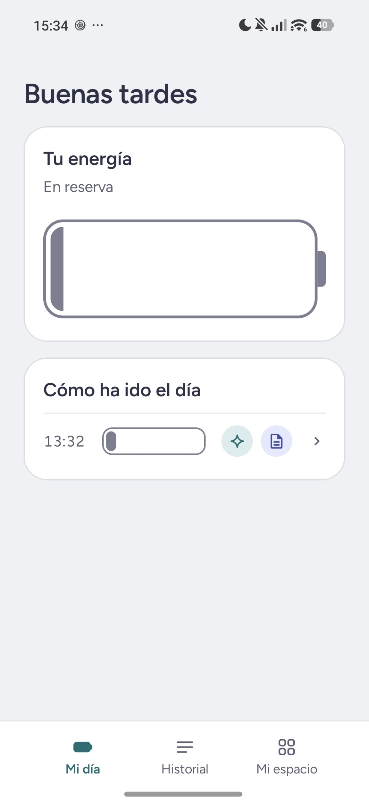
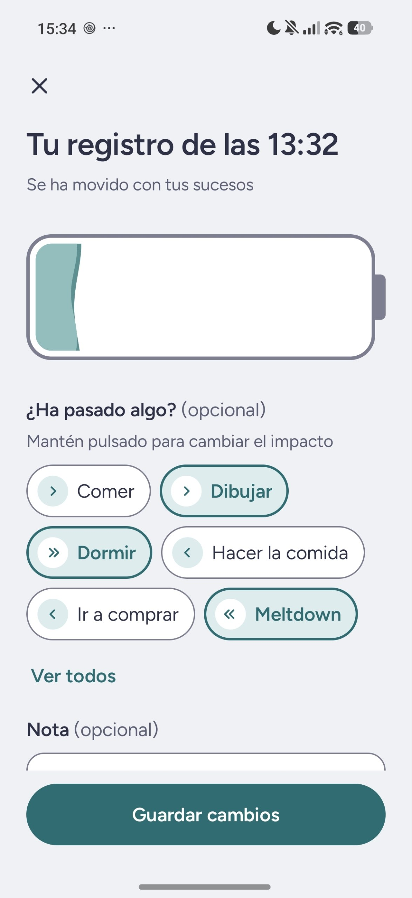
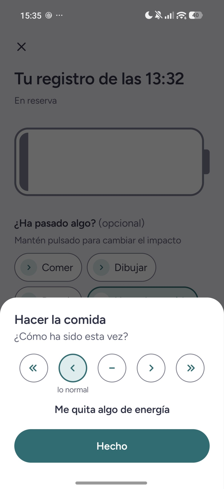
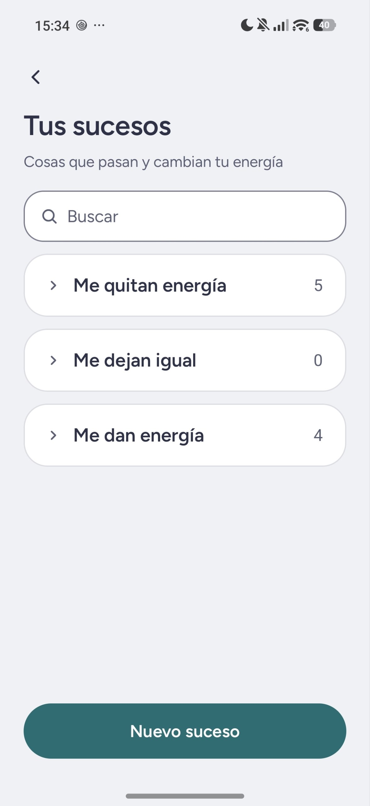
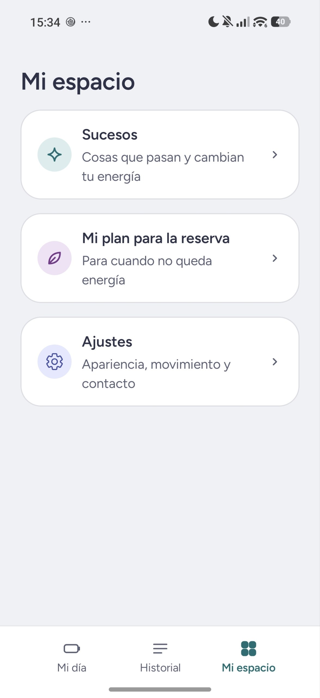
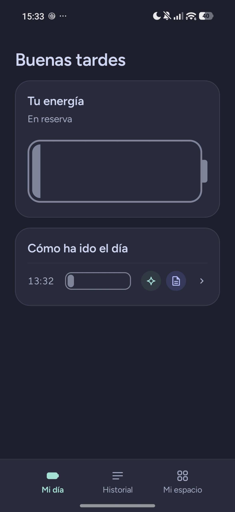
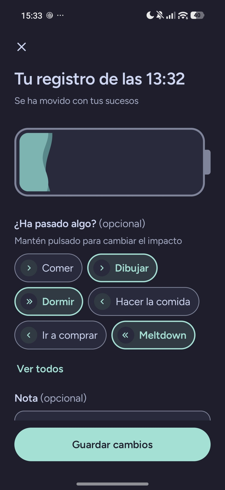
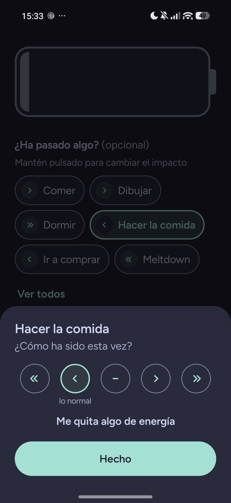
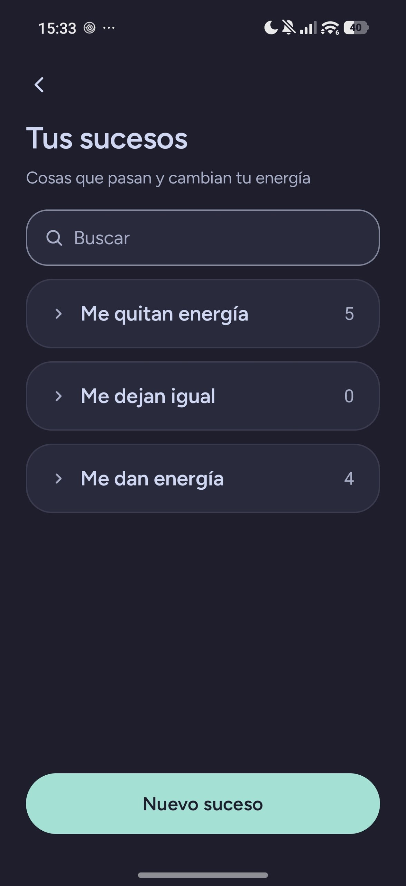
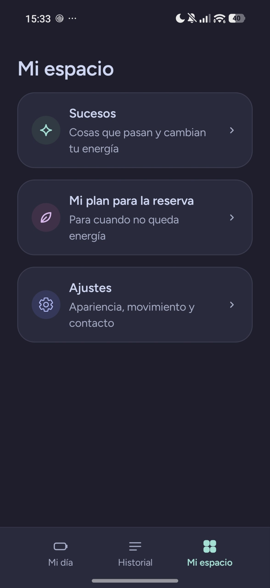

# Mossu

**Tu energía, como una batería. Sin números, sin presión.**

Mossu es una app para Android que te ayuda a registrar cómo está tu energía a lo largo del día. La energía no se marca con números ni porcentajes: se dibuja como una batería que llenas o vacías con el dedo. Si quieres, añades una nota y los sucesos del día: lo que ha pasado y ha cambiado tu energía. Con el tiempo, el historial te deja ver cómo van tus días.

Está pensada sobre todo para personas neurodivergentes (autismo, TDAH…), con fatiga o con energía limitada, y para cualquiera que necesite repartir sus fuerzas sin sentirse juzgada. Si conoces la «teoría de las cucharas», es la misma idea, en forma de batería.

> Versión 0.2.0 · En español · Gratuita · Hecha por Utsiris Labs

## Qué hace

- **Mi día:** tu batería de hoy y la lista de tus registros del día.
- **Registrar:** tocas o deslizas la batería hasta donde estás y, si quieres, escribes una nota. Puedes registrar las veces que quieras, a la hora que quieras.
- **Un registro al empezar el día:** la primera vez que abres la app cada día, te pregunta cómo estás. Se puede omitir siempre, y no insiste.
- **Sucesos:** cosas que pasan y cambian tu energía (una reunión, una mala noche, un paseo). Los creas una vez, diciendo si te quitan o te dan energía, y al registrar solo tienes que tocarlos. La batería se mueve sola con ellos, y siempre puedes ajustarla tú. Si un día algo te afectó distinto de lo normal, lo cambias solo para esa vez.
- **Reserva:** cuando los sucesos te llevan por debajo de vacía, Mossu te lo dice sin alarmas: «En reserva». Si has escrito un plan para esos momentos, lo tienes a un toque.
- **Editar y borrar** los registros de hoy.
- **Historial:** tus días con registros, uno por tarjeta, con sus sucesos. Los días sin registros no aparecen.
- **Mi espacio:** tus sucesos, tu plan para la reserva y los ajustes (apariencia clara, oscura o como el móvil, animación de la batería y contacto).

## Cómo instalarla

1. Descarga el archivo `.apk` de la última versión en [Releases](../../releases/latest).
2. Ábrelo en tu móvil. Android te pedirá permiso para instalar apps de fuera de Google Play: dáselo al navegador o a la app con la que lo abras.
3. Instala y listo.

Necesitas Android 8.0 o superior.

**Si ya tienes la versión 0.1.0:** la 0.2.0 no se instala encima, porque la app ha cambiado de firma. Desinstala primero la 0.1.0 y luego instala la 0.2.0. Al desinstalar se borran los registros que tenías: es un cambio de una sola vez. A partir de la 0.2.0, las versiones nuevas se instalan encima y conservan tus datos.

**Ojo:** desinstalar Mossu borra tus registros.

## Accesibilidad: qué se ha cuidado y por qué

Mossu nace de ocho principios de diseño. La accesibilidad no es un añadido: está en cada decisión.

**Sin números.** La batería guarda un valor por dentro, pero nunca lo enseña. Un número invita a compararse, a ponerse metas y a sentir que «suspendes». Una batería dibujada se entiende de un vistazo y no examina a nadie.

**Los colores no juzgan.** Una batería baja no se pone roja ni muestra alarmas. Tener poca energía no es estar mal: es información para cuidarte. Borrar tampoco va en rojo.

**Sin presión ni culpa.** No hay rachas, contadores de días ni mensajes de «llevas X días sin registrar». Saltarse un día no tiene ninguna consecuencia.

**Poco esfuerzo.** Todo es opcional salvo la batería: la nota, los sucesos, el registro de cada mañana y cuántas veces registras. Guardar es silencioso: la batería y la lista cambian, y no hace falta cerrar avisos.

**Silenciosa.** Ni sonidos, ni vibración, ni notificaciones. Nada que reclame tu atención.

**Movimiento mínimo.** Solo se mueve la batería, y solo cuando la cambias; nada se mueve por su cuenta. Entre pantallas hay un fundido corto y tranquilo, sin saltos ni deslizamientos. Si en tu móvil tienes quitadas las animaciones, Mossu lo respeta. Además, en Ajustes puedes apagar la animación de la batería.

**Todo en su sitio.** Las cosas están siempre en el mismo lugar y nada se reorganiza por sorpresa. Así no hay que volver a buscar lo que ya conoces.

**Lector de pantalla (TalkBack).** La batería se describe con palabras, sin números: «casi vacía», «baja», «algo baja», «a la mitad», «bastante llena», «casi llena» o «llena». Al registrar, se puede subir y bajar con las acciones del lector. Cada registro se lee entero («Registro de las 09:30, batería bastante llena, con nota»). Los títulos están marcados como encabezados para poder saltar entre ellos, todos los botones tienen nombre, y al guardar o borrar se anuncia en voz.

**Letra grande.** Funciona con la letra del móvil al 200 %. Todas las pantallas hacen scroll y los textos pueden ocupar dos líneas sin cortarse.

**Contraste y color.** El texto cumple un contraste de 4,5:1 o más, y la batería y los contornos de 3:1 o más, también en modo oscuro. Nada depende solo del color: la pestaña elegida cambia también de forma y de grosor. Se ha revisado con Accessibility Scanner y con simulación de daltonismo.

**Zonas táctiles cómodas.** Todo lo que se toca mide al menos 48 dp, para no tener que apuntar con precisión.

**Lenguaje sencillo.** Textos cortos y claros, sin jerga, y una tipografía legible (Figtree).

**Calma visual.** Colores suaves, tarjetas con esquinas redondeadas y pocas cosas en cada pantalla. En tablet, el contenido no se estira: se queda centrado, como en el móvil.

## Privacidad

- Mossu **no pide ningún permiso**, ni siquiera el de internet. No puede enviar tus datos a ningún sitio.
- Tus registros se guardan **solo en tu móvil**.
- Lo único que puede salir del móvil es la copia de seguridad automática de Android, en tu cuenta de Google, si la tienes activada. La gestiona Android, no Mossu.
- Sin cuentas, sin anuncios, sin estadísticas de uso.

Textos completos: [Política de privacidad](PRIVACIDAD.md) · [Condiciones de uso](CONDICIONES.md)

## Lo que todavía no hace

Mossu está empezando. Más adelante llegarán los síntomas (enlazados a tus sucesos), recordatorios que configures tú y estadísticas que te dejen ver qué te vacía y qué te recarga.

## Contacto

Dudas, errores o ideas: **utsirislabs@gmail.com**, o desde la propia app (Ajustes › Contacto y privacidad › Escribir a Utsiris).

## Licencias

- Mossu: © 2026 Utsiris Labs. Todos los derechos reservados. Puedes descargarla y usarla gratis; el código no es público.
- Tipografía [Figtree](https://github.com/erikdkennedy/figtree), bajo licencia SIL Open Font License 1.1.
- Iconos inspirados en [Material Symbols](https://fonts.google.com/icons) (estilo redondeado), bajo licencia Apache 2.0.
